# Cisco IOS Image Recovery Lab Packet Tracer

Can you believe it?

An intern has accidentally deleted the operating system from router R1.

Without an IOS image, the router cannot boot normally, and all network connectivity is lost.

A bit of a nightmare!

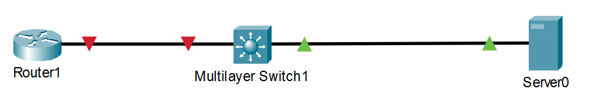

The CLI of R1 shows that the boot process failed and is in **ROM Monitor (ROMMON) mode**.

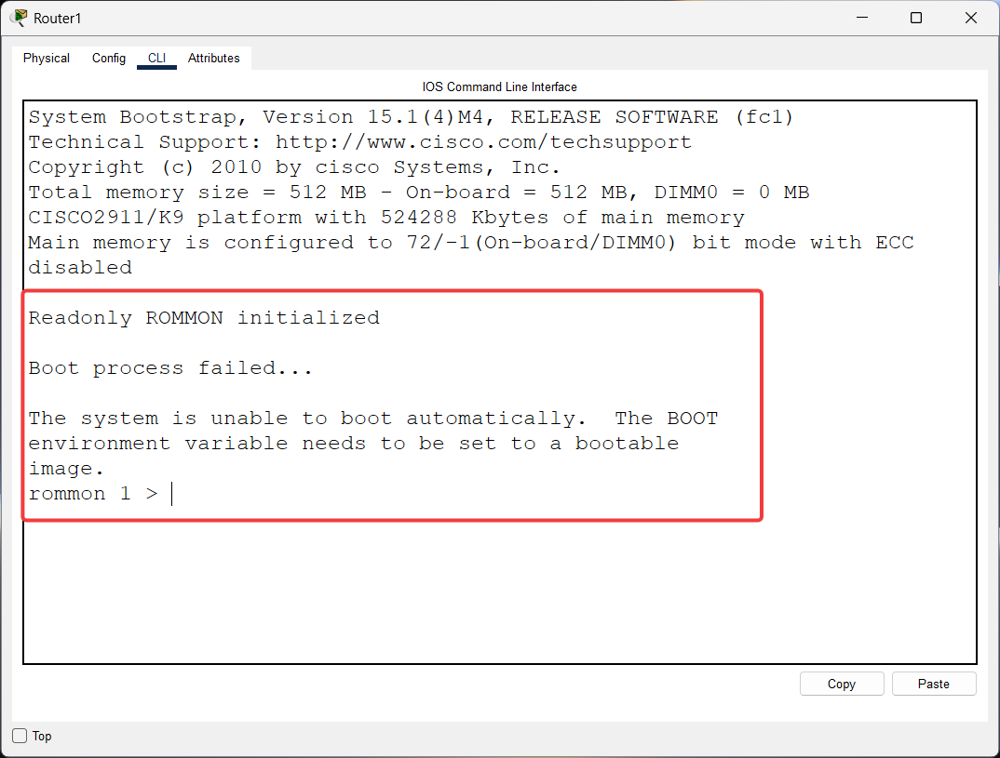

Even trying to reboot the router using the `reset` command takes us straight back into ROMMON mode.

Fortunately, we have a TFTP server in our network that contains a backup of the IOS image.

## Lab Objectives

1. Restore the router's operating system from the TFTP server.
   - **IOS image:** `c2900-universalk9-mz.SPA.151-4.M4.bin`
2. Ensure the router boots correctly into Cisco IOS.
3. Verify that the router can ping the TFTP server (`10.1.1.100`) and the switch (`10.1.1.2`).

**[Download the Packet Tracer lab](Missing%20IOS.pkt)**

## Troubleshooting and Recovery

1. In ROMMON mode, enter `?` to view the available commands and `dir flash:` to confirm that no IOS image is present in Flash.

   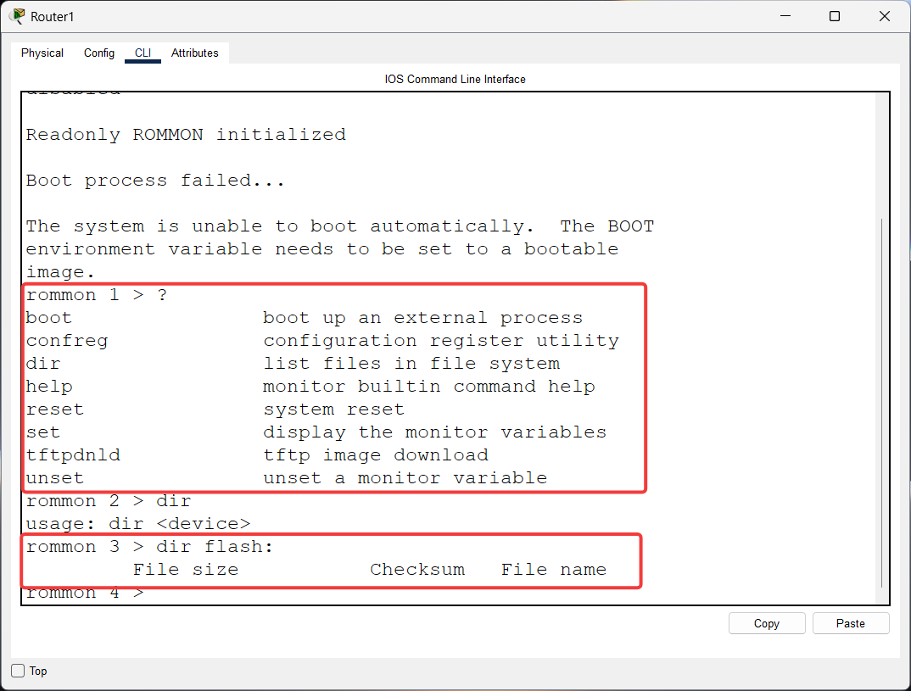

2. Use `tftpdnld` to restore the IOS image from the TFTP server to the router's Flash memory.

   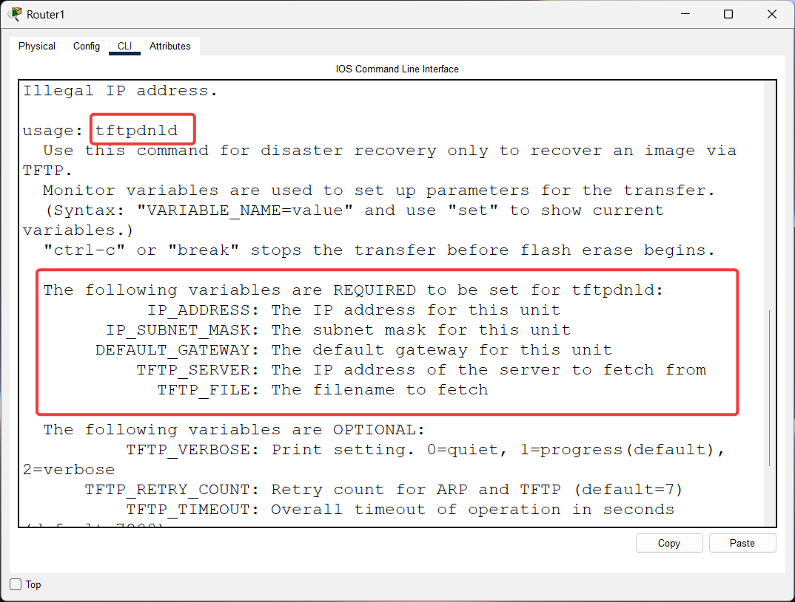

   To run `tftpdnld`, we need to configure the required network information.

3. On the TFTP server (Server0), open the command prompt and check its network configuration.

   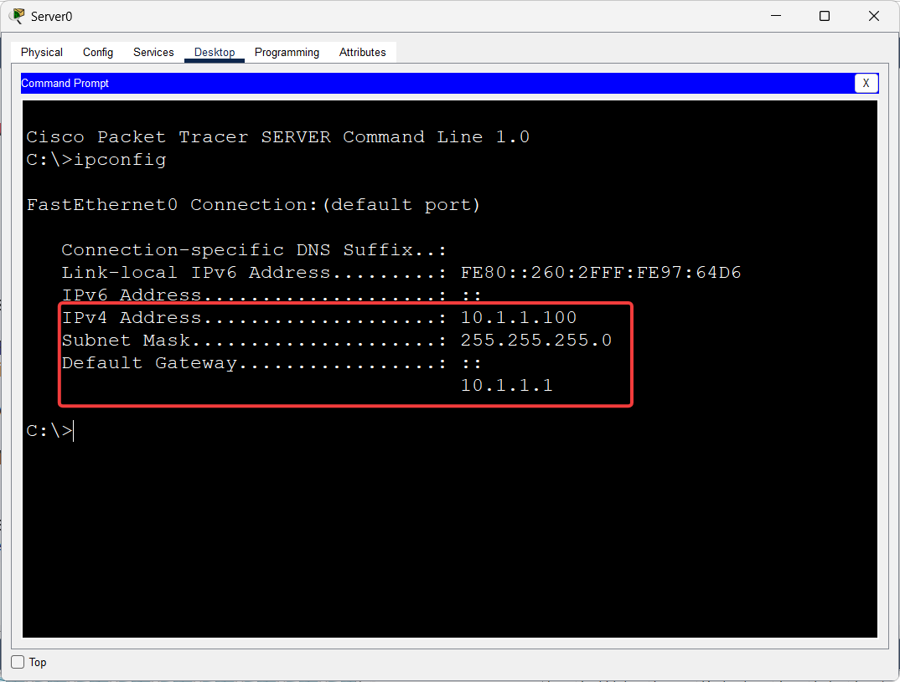

   | Parameter | Value |
   |---|---|
   | Default gateway (R1 IP) | `10.1.1.1` |
   | Subnet mask | `255.255.255.0` |
   | TFTP server IP address | `10.1.1.100` |
   | IOS image | `c2900-universalk9-mz.SPA.151-4.M4.bin` |

   In Packet Tracer, you can find the exact IOS image filename by opening **Server0 → Services → TFTP** and checking the list of available files.

   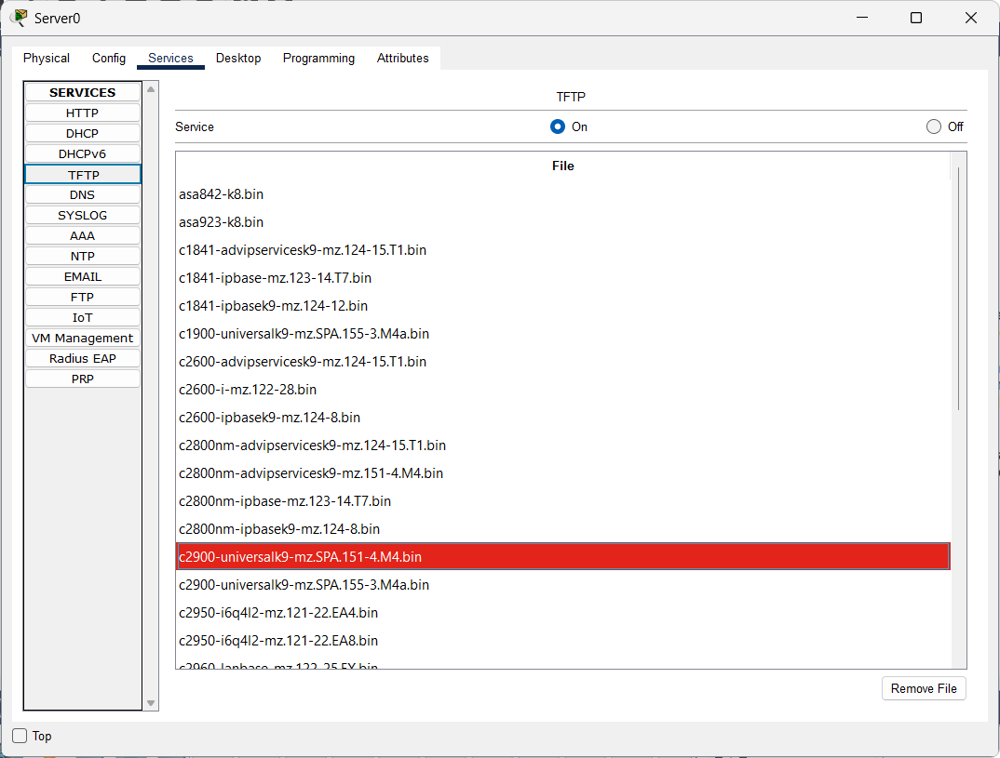

   `c2900-universalk9-mz.SPA.151-4.M4.bin`

4. Back on R1, configure the variables required for the TFTP download.

   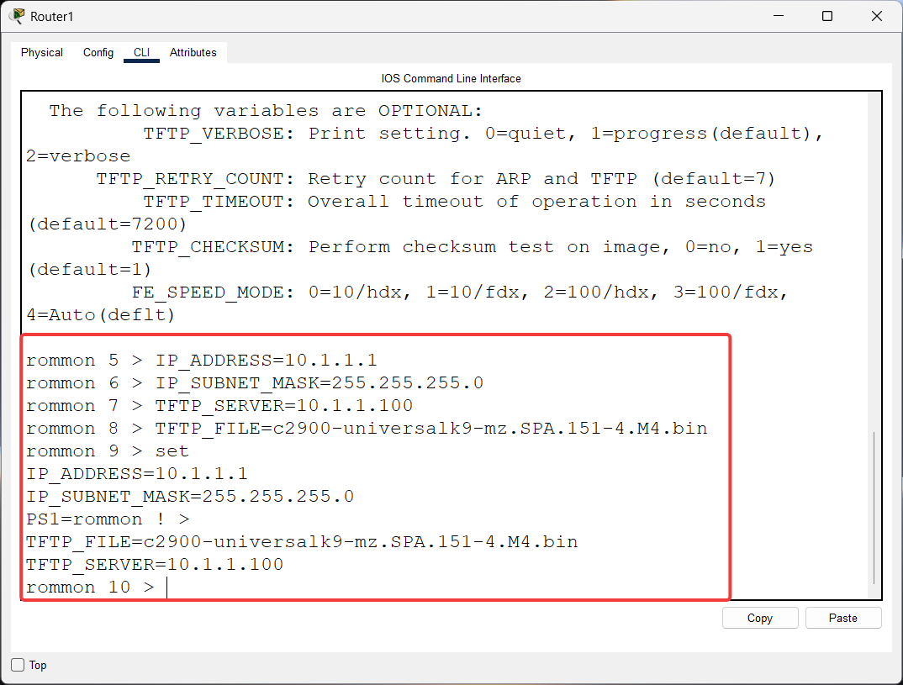

   **Note:** In this case, I needed to specify a `DEFAULT_GATEWAY` value for `tftpdnld` to work. However, since the router and TFTP server are on the same subnet, no gateway is actually needed for communication between them. Some real Cisco ROMMON implementations also require this variable to be configured, even when no routing is necessary.

5. Start the download process using `tftpdnld` and enter `y` to continue.

   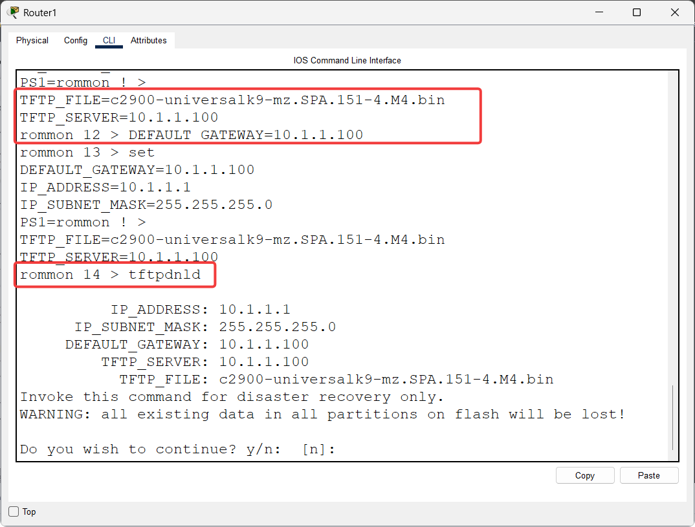

6. The router downloads the IOS image from the TFTP server and saves it to Flash memory.

   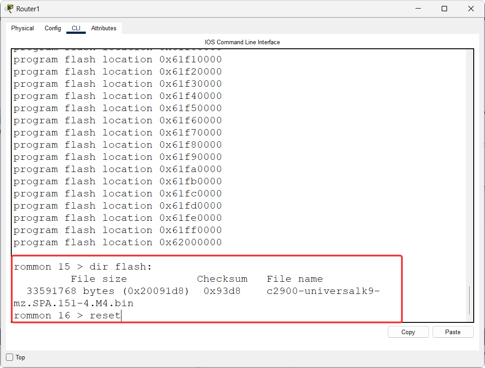

7. The router now boots successfully into Cisco IOS.

   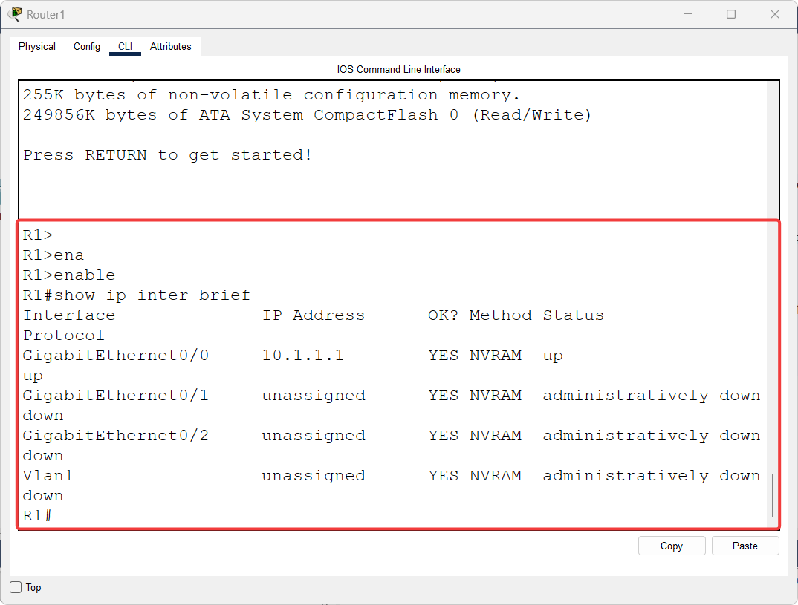

8. Verify that the router's configuration is still present and that connectivity is working correctly.

   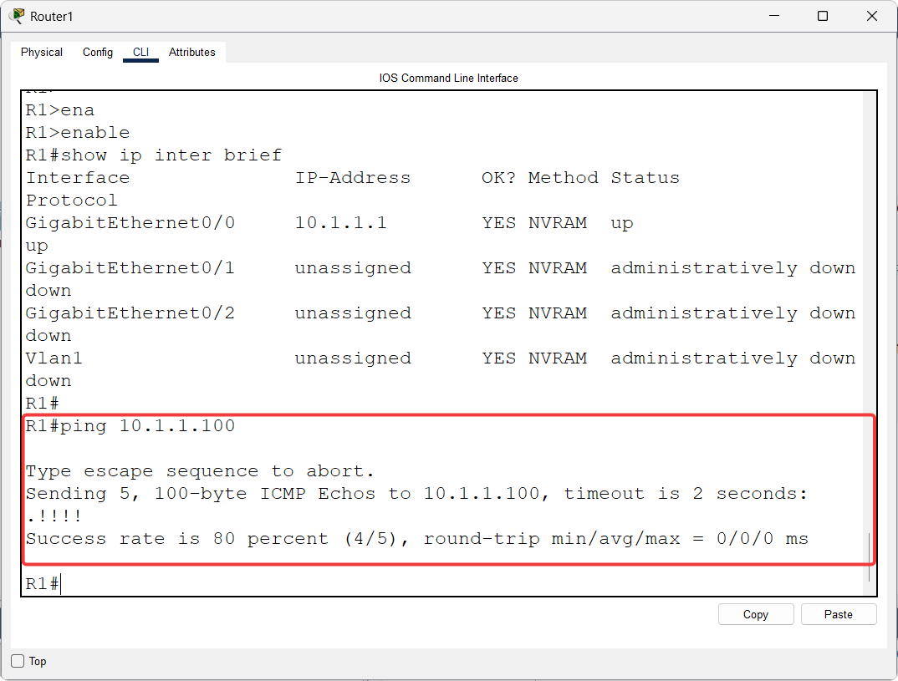

**Note:** Although `tftpdnld` erases files stored in the router's Flash memory, the startup configuration remains intact because it is stored in NVRAM.

## Cisco Documentation

1. [Cisco 3900, 2900, and 1900 Series — Using ROM Monitor](https://www.cisco.com/c/en/us/td/docs/routers/access/1900/software/configuration/guide/Software_Configuration/appendixCrommon.html)
2. [Cisco — Understand How to Back Up and Restore Configuration Files](https://www.cisco.com/c/en/us/support/docs/ios-nx-os-software/ios-software-releases-122-mainline/46741-backup-config.html)